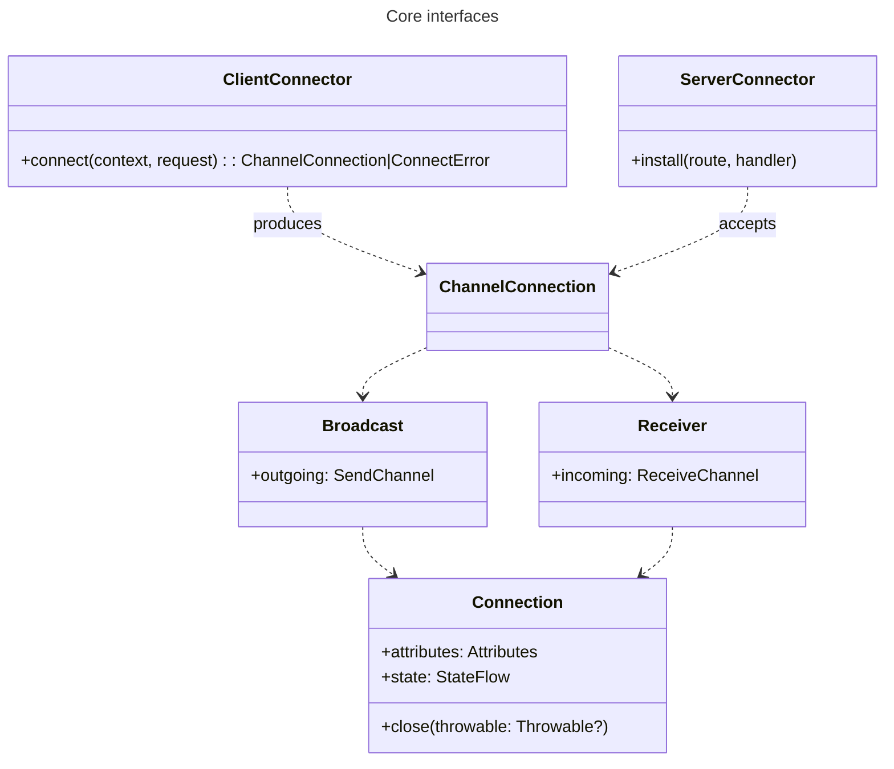

|           |                                                 |
|-----------|-------------------------------------------------|
| Feature   | Message Protocol Abstraction                    |
| Submitted | 2026-11-06                                      |
| Accepted  | No                                              |
| Issue     | https://youtrack.jetbrains.com/issue/KTOR-10142/ |
| Prototype | https://github.com/bjhham/ktor-ws-experimental/ |

### Contents

1. [Summary](#summary)
2. [Motivation](#motivation)
3. [Current Solutions](#current-solutions)
4. [Design Overview](#design-overview)
5. [Design Details](#design-details)
   1. [Connector implementations](#connector-implementations)
   2. [Connector algebra](#connector-algebra)
   3. [Failures and lifecycle management](#failures-and-lifecycle-management)
      1. [Failure to connect](#failure-to-connect)
      2. [Connection interruptions](#connection-interruptions)
      3. [Tracking connection state](#tracking-connection-state)
6. [Drawbacks](#drawbacks)
7. [Advantages](#advantages)
8. [Open Questions](#open-questions)
9. [Future Directions](#future-directions)

<hr />

# Summary
[summary]: #summary

This proposal introduces a set of abstractions for two-way message channels and their orchestration.  The overall goal is to solve several shortcomings in Ktor's WebSocket handling while improving the extensibility of the API.  

# Motivation
[motivation]: #motivation

Over the years, we've had quite a few requests to expand Ktor's WebSocket handling.

There have been requests for higher-level protocol implementations over web sockets:
- [KTOR-448](https://youtrack.jetbrains.com/issue/KTOR-448) Socket.io like WebSockets
- [KTOR-790](https://youtrack.jetbrains.com/issue/KTOR-790) SockJS support
- [KTOR-612](https://youtrack.jetbrains.com/issue/KTOR-612) WebSocket client with STOMP

And there have been several requests for usability improvements in the API:
- [KTOR-3605](https://youtrack.jetbrains.com/issue/KTOR-3605) Provide Flow for WebSockets API
- [KTOR-4323](https://youtrack.jetbrains.com/issue/KTOR-4323) Websockets with Kotlinx serialization: Support custom serializer
- [KTOR-5779](https://youtrack.jetbrains.com/issue/KTOR-5779) Simplify Serialization from Websocket
- [KTOR-5869](https://youtrack.jetbrains.com/issue/KTOR-5869) Add secure equivalent of HttpClient.webSocketSession
- [KTOR-6267](https://youtrack.jetbrains.com/issue/KTOR-6267) Allow Websocket client to access handshake headers (ex: Sec-WebSocket-Protocol)
- [KTOR-7549](https://youtrack.jetbrains.com/issue/KTOR-7549) WebSockets: Provide extension points to get notified on WebSocket connection open and close
- [KTOR-7718](https://youtrack.jetbrains.com/issue/KTOR-7718) WebSockets: Enhanced WebSocket Header Customization
- [KTOR-9228](https://youtrack.jetbrains.com/issue/KTOR-9228) WebSocketStream API support

If we filter these requests into a few themes, the main asks can be summarized with:
1. Support for lifecycle management
2. Improved events mapping and management
3. Handshake negotiation and access

All three of these enhancements are partially blocked by our current solutions on both server and client.  We'll provide some more details in the next section. 

# Current Solutions
[current-solutions]: #current-solutions

Ktor has WebSocket implementations for both client and server.

## Server implementation

To configure a server to use WebSockets, you must first install the plugin:

```kotlin
install(WebSockets) {
    pingPeriod = 15.seconds
    timeout = 15.seconds
    maxFrameSize = Long.MAX_VALUE
    masking = false
}
```

Then you can introduce WebSocket endpoints to your routing:

```kotlin
routing {
    webSocket("/echo") {
        send("Please enter your name")
        for (frame in incoming) {
            frame as? Frame.Text ?: continue
            val receivedText = frame.readText()
            if (receivedText.equals("bye", ignoreCase = true)) {
                close(CloseReason(CloseReason.Codes.NORMAL, "Client said BYE"))
            } else {
                send(Frame.Text("Hi, $receivedText!"))
            }
        }
    }
}
```

The receiver in the `webSocket` lambda scope is [WebSocketServerSession](https://github.com/ktorio/ktor/blob/main/ktor-server/ktor-server-plugins/ktor-server-websockets/common/src/io/ktor/server/websocket/WebSocketServerSession.kt),
which holds the `incoming` and `outgoing` channels for the frames.  You can also access the underlying request via the `call` property, and you are equipped with some session-specific functions like `flush()` and `close()`, along with other WebSocket-specific properties like `maxFrameSize` and `masking`.

To translate the frames into domain types, you can assign a `converter` in the plugin configuration, then later call `receiveDeserialized<T>()` and `sendSerialized<T>()`.  These are reified functions that pass the type info to the converter so that it may handle the message accordingly.

## Client implementation

Our client implementation bears a similar API to the server's.

Here's how a client request looks:

```kotlin
suspend fun main() {
    val client = HttpClient(CIO) {
        install(WebSockets) {
            pingIntervalMillis = 20_000
        }
    }
    client.webSocket(method = HttpMethod.Get, host = "127.0.0.1", port = 8080, path = "/echo") {
        while (true) {
            val othersMessage = incoming.receive() as? Frame.Text
            println(othersMessage?.readText())
            val myMessage = Scanner(System.`in`).next()
            if (myMessage != null) {
                send(myMessage)
            }
        }
    }
    client.close()
}
```

## Problems with the current design

There are a few problems that might be apparent when reviewing the session receiver's makeup:
1. We are mixing the scope of the connection establishment, request handling, and the frame interchange
2. The translation (serialization) layer requires plugin configuration and additional type knowledge inside the session
3. There's no means for handling disconnects or other lifecycle events
4. The WebSocket plugin acts on the client's requests from a distance, and its unclear which features belong to which scope

Making changes to address these issues would require breaking API compatibility, so we'll likely need to introduce a new 
API that can be consumed independently. On top of addressing the issues above, it would be ideal if we could provide 
a standardized abstraction layer with composable types.  In the next section, we'll illustrate what this might entail.

# Design Overview
[design-overview]: #design-overview

To handle the disparate requests listed previously, we intend to provide a new modular connection abstraction layer.

For this, we'll need to depart from our conventional 1:1 HTTP handling and refocus our approach on bidirectional messaging as a standalone concept.

As a starting point for the new API, we can introduce a single client function for any kind of connections, determined by the argument.

In the base case, we roughly mimic the existing WebSockets API:

```kotlin
val client = HttpClient()

client.connect(WebSockets, "/messages") {
    for (message in incoming) {
        if (message !is Frame.Text) continue
        val number = message.readText().toInt()
        val response = buildString {
            if (number % 3 == 0) append("Fizz")
            if (number % 5 == 0) append("Buzz")
        }.takeIf { it.isNotEmpty() } ?: continue
        
        outgoing.send(Frame.Text(response))
    }
}
```

But with the distinction that the connector, supplied as `WebSockets` above, would be a composable type with its own set of helper functions.

This would allow for some simplifications on this basic example:

```kotlin
client.connect("/messages", WebSockets.Text.mapIncoming(String::toInt)) {
    for (number in incoming) {
        val response = buildString {
            if (number % 3 == 0) append("Fizz")
            if (number % 5 == 0) append("Buzz")
        }.takeIf { it.isNotEmpty() } ?: continue

        outgoing.send(Frame.Text(response))
    }
}
```

And on the server side, we can the inverse connector:

```kotlin
val numbers = [121, 873, 1785]
routing {
    listen("/messages", WebSockets.Text.mapOutgoing(Int::toString)) {
        for (n in numbers) {
            outgoing.send(n)
            val fizz = number % 3 == 0
            val buzz = number % 5 == 0
            if (!fizz || !buzz) continue
            when (val msg = incoming.receive()) {
                "Fizz" -> assert(fizz && !buzz)
                "Buzz" -> assert(buzz && !fizz)
                "FizzBuzz" -> assert(fizz && buzz)
                else -> error("Invalid message: $msg")
            }
        }
    }
}
```

The composability of the typed connector itself allows for more advanced transformations of the protocol.  We can, for 
example, introduce a reconnecting wrapper to the WebSocket session, or provide a STOMP-over-WebSockets translation.

For a very simple example of how it can be used to augment WebSockets, we can introduce a basic `kotlinx-serialization` 
transformation:

```kotlin
inline fun <reified M> ClientConnector<Frame, Frame>.withFormat(
  format: StringFormat,
  serializer: KSerializer<M> = serializer<M>(),
): MessageDuplex<M> { /*...*/
}

client.connect(WebSockets.withFormat<MyChatMessage>(Json)) {
  for (message in incoming) {
    when (message.author.id) {
      0L -> TODO("Domain logic goes here")
    }
  }
}
```

In the next section, we'll explore the interfaces and see how they fit together.

# Design Details
[design-details]: #design-details

Here is a diagram of the core interfaces:



And these connection types lead us to the core extension on the `HttpClient`:

```kotlin
// With connection scope...
suspend fun <Out, In> HttpClient.connect(
  connector: ClientConnector<Out, In>,
  request: ConnectRequest,
  handleConnection: suspend ChannelConnection<Out, In>.() -> Unit,
): Unit = handleConnection(connector.connect(
  HttpClientConnectionContext(this),
  request
).orThrow())

// Which calls into...
suspend fun <Out, In> HttpClient.connect(
  connector: ClientConnector<Out, In>,
  request: ConnectRequest,
): ChannelConnection<Out, In>|ConnectError
```

Then to provide the function call from the previous section `client.connect(WebSockets, "/messages")`, we provide a 
`ClientConnector` implementation:

```kotlin
val WebSocket = ClientConnector { context, request ->
  val client = context.httpClient.takeIf { it.pluginOrNull(WebSockets) != null }
    ?: context.httpClient.config { install(WebSockets) }
  val session = client.webSocketSession {
    url(request.url)
    headers.appendAll(request.headers)
  }
  val responseHeaders = session.call.response.headers
  val attributes = Attributes(concurrent = true).apply {
    put(ConnectionAttributes.Url, request.url)
    put(ConnectionAttributes.ResponseHeaders, responseHeaders)
    responseHeaders[HttpHeaders.SecWebSocketProtocol]?.let {
      put(WebSocketAttributes.Subprotocol, it)
    }
  }
  session.toConnection(context.coroutineContext, attributes)
}
```

In the implementation, we wrap the `WebSocketSession` with a `ChannelConnection` adapter.  In this case, it is
parameterized by `Frame` in both input and output type parameters.

### Connector Implementations
[connector-implementations]: #connector-implementations

In our prototype, we focus only on the `WebSocket` implementation.  There is an opportunity to align other discrete 
connections in the project under a common interface, like UDP sockets with data frames, Server-Sent Events, or even raw 
TCP sockets.

We'll just reference the few that will be available in the initial release of the feature:

| Implementation | Description |
| -- | -- |
| `WebSocket` | Handles the WebSocket handshake and all events, over the receiver's WebSocket connection |
| `Websocket.Text` | Automatically filters frames to only `Text` frames, so that the developer can work exclusively with the text frames |
| `Websocket.Binary` | Similar to the `Text` implementation, but for binary data |

### Connector Algebra
[connector-algebra]: #connector-algebra

To illustrate how the new abstraction can cover all the required scenarios, different implementations and utility 
functions were included in the prototype project.

In the following table, you can find all implementations for modifying connectors for establishing connections:

| Function (receiver: `ClientConnector<I, O>`) | Description |
| --- | --- |
| `mapIncoming<T>((I) -> T): ClientConnector<T, O>` | Transforms the incoming messages to a new type |
| `mapOutgoing<T>((T) -> O): ClientConnector<I, T>` | Transforms the outgoing messages from a new type |
| `map<T, S>((I) -> T, (S) -> O): ClientConnector<T, S>` | Translates both input and output |
| `withFormat<T>(TextFormat): ClientConnector<T, T>` | Provides serialization to/from the provided type argument and `TextFormat` (i.e., `Json`) |
| `withFormat<T>(BinaryFormat): ClientConnector<T, T>` | Similar to the previous but for binary formats |
| `withReconnect(ReconnectDelay): ClientConnector<I, O>` | Wraps a connection with a reconnect strategy, providing a resilient connection |
| `withStomp(): ClientConnector<I, O>` | Handles the stomp handshake and all events, over the receiver's connection |

We can also apply similar functions to the connections produced by the connectors:

| Function (receiver: `ChannelConnection<I, O>`) | Description |
| --- | --- |
| `mapIncoming<T>((I) -> T): ChannelConnection<T, O>` | Transforms the incoming messages to a new type |
| `mapOutgoing<T>((T) -> O): ChannelConnection<I, T>` | Transforms the outgoing messages from a new type |
| `map<T, S>((I) -> T, (S) -> O): ChannelConnection<T, S>` | Translates both input and output |
| `withFormat<T>(TextFormat): ChannelConnection<T, T>` | Provides serialization to/from the provided type argument and `TextFormat` (i.e., `Json`) |
| `withFormat<T>(BinaryFormat): ChannelConnection<T, T>` | Similar to the previous but for binary formats |
| `asFlow(): Flow<I>` | Consumes input channel as a flow; opening up the `Flow` API |

With regards to `asFlow()`: the lifetime of the connection should be bound to the flow, so that when it is consumed, the connection is closed.  Another matter is how sending messages during flow consumption should be facilitated.

### Failures and Lifecycle Management
[failures-and-lifecycle-management]: #failures-and-lifecycle-management

One of the gaps in our current implementation of WebSockets is the lack of hooks for handling errors and changes in the connection states.  For this, we provide a connection state flow on every new connection instance, while also providing a general framework for handling errors while connecting or during the lifetime of the connection.

#### Failure to Connect
[failure-to-connect]: #failure-to-connect

Ideally, all attempts to connect that end in failure should be incorporated into the function's signature.  For this, we can use rich errors:

```kotlin
typalias ConnectError = Rejected | NetworkError
```

Where `NetworkError` can encapsulate timeouts and disconnects and rejection can encapsulate all deliberate failures from the server.

When using rich errors as part of the scoped a connect lambda, these will need to be thrown in the parent scope instead.  Alternatively, we could forgo the use of the scoped function for handling the connection lifecycle, however this would delegate the responsibility of closing the connection to the user.

#### Connection Interruptions
[connection-interruptions]: #connection-interruptions

When using long-running connections, it's common for disruptions to occur.  To provide the best experience, it is our prerogative to expose the full catalogue of possible errors that might occur during the lifetime of a connection, so that they may be acted upon accordingly for reconnection or reporting.

Based on our research of different protocols, we came up with this list:

| Error | Recoverable | Description |
|-------|-------------|--|
| Closed | Sometimes | Peer has deliberately closed the connection |
| Dropped | Yes| Peer disconnected without providing a reason|
| Timeout | Yes| Connection remains open but no activity for pre-defined duration |
| Violation | No| Bad data was sent over the wire |
| GaveUp | No| Reconnection attempts are exhausted |

Any of these could be thrown while trying to read a message from the channel.  Importantly, we need to communicate all these failures in a consistent way, as opposed to our current approach that oftentimes defers exception types to the underlying engine.

One question remains whether an exception ought to be thrown when the remote end closes normally.  Since the lifetime of the connection is bound to the coroutine, then any event that would cancel the coroutine should throw an exception.  However, this becomes less ergonomic when using patterns where we read an unknown number of messages from the peer - for this reason I would argue for handling these situations within any DSL scopes without bubbling them up.  Closure events can also be handled within the state flow, which should be flushed prior to cancelling the coroutine.

### Tracking Connection State
[tracking-connection-state]: #tracking-connection-state

The state of the underlying connection can change many times without affecting the interaction with the connection.  For this reason, we propose that every connection ought to have an event stream for changes in the connection state that can be used for instrumentation.

So, on each `ChannelConnection`, we have a `StateFlow<ConnectionState>` where the `ConnectionState` is a sealed type of:

```kotlin
sealed interface ConnectionState {
    data object Connecting : ConnectionState

    data class Connected(val attributes: Attributes, val reconnects: Int) : ConnectionState

    data class Reconnecting(
        val attempt: Int,
        val cause: Throwable?,
        val nextDelay: Duration? = null,
    ) : ConnectionState

    data class Closing(val initiatedBy: CloseInitiator) : ConnectionState

    data class Closed(val info: CloseInfo) : ConnectionState {
        val cause: Throwable? get() = info.error
    }
}
```


# Drawbacks
[drawbacks]: #drawbacks

- **API clutter.** We're introducing more functions and API to an already sizable API.
- **Compositional nuance.** There are several cases where the order of wrapping connectors will have an impact on the behavior.
- **Predictability.** Introducing a highly-expressive API like this could lead to scenarios that we fail to predict.

# Advantages
[advantages]: #advantages

- **Commonized connection types.** Transports, layers, client and server all use `MessageConnection`, so code
  that consumes messages doesn't care whether it's WebSockets, long-polling or an in-memory pair. It also doesn't
  care which layers sit underneath.
- **Composition instead of configuration.** Each feature is a small wrapper with one responsibility. You add new
  behavior (compression, logging, a Socket.io-style protocol) by writing another layer or connector, without
  touching the core or the `HttpClient` setup.
- **Standard coroutine semantics.** Plain channels mean select, flows, iteration and backpressure work as usual.
  Structured concurrency gives each connection a clear owner, so helper coroutines can't leak, and failures
  propagate the same way at every level.
- **No action at a distance.** Connection behavior lives in the connector value, not in client plugin settings.
  This includes the serialization format, subprotocols, STOMP credentials and the reconnect policy. Two
  connections from the same client can use completely different setups.
- **Information flows both ways.** `ConnectRequest` carries URL, headers and attributes in; `attributes` carries
  handshake results out (response headers, negotiated subprotocol, STOMP `CONNECTED` frame).
- **Client and server share code.** Formats and protocol layers are written once and used on both sides.
- **Resilience built in** Reconnects keep the same channels. They are paced by pluggable
  `ReconnectDelay` strategies, report `ConnectionState`, sort failures into retryable and fatal ones, and let
  layers above restore their state through `onReconnect`.
- **Testable.** `MessageConnection.pair()` and `ConnectionContext` let you test layers and reconnect logic with
  virtual time, without starting a server.
- **Small surface.** Most user-facing API is extension functions on a few interfaces.

# Open Questions
[open-questions]: #open-questions

- **Synergy with existing APIs.** We have yet to look through the Ktor project to see if any other types would benefit from the new interfaces here.
- **Lifecycle events.** We need to address how to handle all lifecycle events for different connection types within this API.
-  **Sending from Flow.** We'll need to investigate our options for sending messages when consuming from a connection converted to a `Flow`.
- **Connection closures.** What should the default behavior be when the peer closes a connection normally while you are waiting for a message or trying to send.

# Future Directions
[future-directions]: #future-directions

Some of the feature requests listed under the "Motivation" section will be slotted for future releases, though the 
patterns described in this proposal could be used for a wide variety of problems.